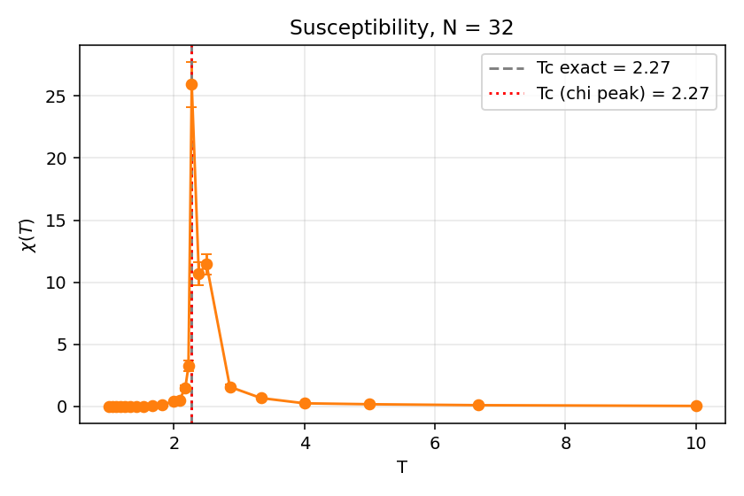

# MCMC Sampling of the 2D Ising Model

Metropolis sampling of the 2D Ising model with periodic boundary conditions, used to study its phase transition. Developed for the Computer Programming course at Bocconi University (2025).



## Results

Lattice size N = 32, 3 independent chains per temperature.

| Quantity | Estimate | Exact |
|---|---|---|
| Critical temperature Tc (susceptibility peak) | 2.27 | 2.269 |
| Susceptibility exponent γ | 1.84 | 1.75 |
| Magnetization exponent β | 0.084 | 0.125 |

The β exponent is underestimated because the magnetization is rounded near Tc on a small lattice. Near Tc, cluster sizes become approximately scale free and a single spanning cluster appears.

## Implementation

- Single-spin-flip Metropolis sampler with O(1) energy updates
- Vectorised energy computation with NumPy
- Flood-fill cluster detection, close to O(N²)
- Fixed seeds for reproducible figures, and cached results for the long runs

## Files

| File | Contents |
|---|---|
| `Ising.py` | Ising class: cost, delta cost, magnetization, display |
| `mcmc.py` | Metropolis single-spin-flip sampler |
| `Clusters_Ising.py` | Flood fill returning the list of cluster sizes |
| `Isingrun.py` | Small example: samples a configuration and finds its clusters |
| `explore_mcmc.py` | Snapshots, burn-in study, acceptance and cost versus T and N |
| `Ising_properties.py` | Magnetization, susceptibility, critical exponents, clusters |
| `report.pdf`, `report.tex` | Report and its source |
| `figures/`, `data/` | Plots and cached MCMC results |

## How to run

```bash
pip install -r requirements.txt
python3 Isingrun.py            # quick check of the core methods
python3 explore_mcmc.py        # regenerates the MCMC exploration figures
python3 Ising_properties.py    # redraws the critical-behaviour figures from the cache
```

Add `--recompute` to the last command to rerun the long MCMC from scratch.
